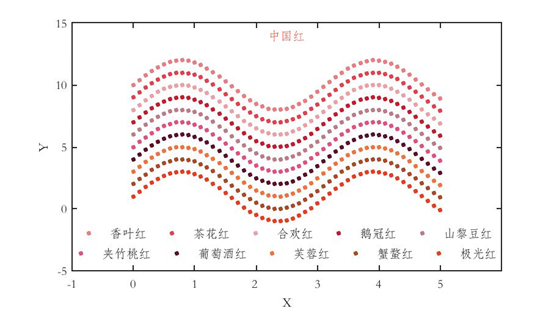

# MATLAB 526 Chinese color plotting subroutines

\n        \n      Briefly introduce the origin and characteristics of this drawing subroutine:  
(1) Requirements from MATLAB plotting in the author's research process;  
(2) In search of aesthetically pleasing colors + poetic names;  
(3) Completed the Chinese color spectrum (http://zhongguose.com/#anyuzi) at 1:1, directly presenting the upgraded subroutine and its manual below.

## Images

<!-- PAYMENT_BLOCK -->

## Get this dataset

- Payment link (Stripe): [Buy now](https://buy.stripe.com/3cs8yP7sY87d0vu9AB)
- Payment QR code: 

<!-- /PAYMENT_BLOCK -->
